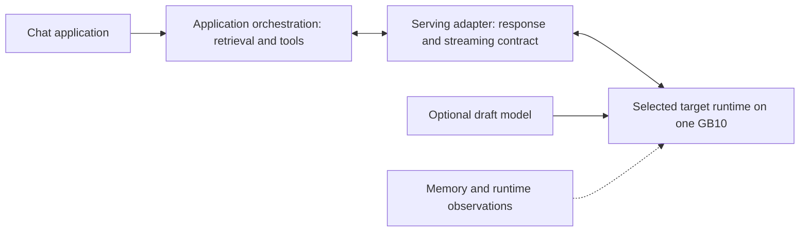

# DGX Spark LLM Journey — Local LLM Inference Engineering

A documentation case study of selecting and debugging local LLM inference on a **single NVIDIA DGX Spark / GB10 with 128 GB unified memory**. The archived engineering inventory covers **six public LLM checkpoints and ten launched Model × Runtime configurations**, including vLLM, SGLang, DFlash2, MTP, and NEXTN. These are deployment counts, not ten complete benchmark comparisons.

**Status: POC / candidate deployments, not a Production Release.** This portfolio focuses on inference engineering, not the separate QLoRA training journey.

單台 GB10 的重點不只是能載入模型，而是如何選擇 Runtime、保留記憶體餘裕，並確認測速究竟量到思考還是答案。此案例保留失敗分析與證據限制，不以跨條件數字宣稱加速成果。

## Key Engineering Highlights

- **Compare complete configurations:** BF16 and NVFP4 on the same vLLM and script, with explicit disclosure that KV dtype and Tool Parser also changed.
- **Choose a practical inference stack:** adopt 27B NVFP4 with SGLang and DFlash2 based on archived single-stream observations, functional smoke checks, and deployment maintainability.
- **Audit the output, not just tok/s:** identify reasoning-only outputs and invalid synthetic-token tests before interpreting workload performance.
- **Preserve resource headroom:** unified memory is shared with the system; observe available system memory and treat FP8 KV, model weights, and speculative decoding as separate resource choices.
- **Debug the serving contract:** reasoning and tool parsers, streaming behavior, and checkpoint selection can change what the user sees without changing model quality.

## Platform and Runtime Choices

| Component | Archived scope |
|---|---|
| Hardware | One GB10, sm121, 20-core ARM CPU, 128 GB unified memory |
| Runtime | vLLM 0.27.1 / NGC 26.08; SGLang 0.5.20 and 0.5.21; a community vLLM build and a SGLang development build |
| Precision | BF16 targets; ModelOpt NVFP4 mixed-precision exports; FP8 KV on the selected 27B lane |
| Speculation | DFlash2; vLLM MTP; SGLang NEXTN, with model-dependent results |
| Deployment discipline | Separate model configurations, version locking, and one large model active at a time |

## Abstract Serving Architecture

This diagram shows logical responsibilities only. It contains no network topology or deployment configuration. Application orchestration and model serving have separate responsibilities; monitoring integration still needs completion and validation.

## Selected Archived Results

| Test | Result | Interpretation |
|---|---|---|
| 27B, vLLM, thinking OFF | BF16 **4.40–4.52**; NVFP4 **12.22–12.40 tok/s** | Same runtime and script; KV dtype and Tool Parser also changed, so this does not isolate quantization causality |
| Same comparison, 6,528-token prompt | TTFT **6.03 s** versus **2.91 s** | A prompt-length-specific observation, not a universal latency claim |
| 27B NVFP4 + SGLang + DFlash2, real-text tests | TTFT **134–140 ms**; decode **33.35–42.02 tok/s** | Single stream, thinking enabled by default; response text was not retained, so the generation phase is unknown |
| Cross-model thinking-ON suite | Selected 27B lane TTFT **122–207 ms** | First four workload rows for 27B and Mia Flash-Next generated reasoning only; these are not answer-speed results |

These rows are separate tests and must not be combined into a speedup ratio. Small quality smoke tests do not establish BF16/NVFP4 equivalence or general accuracy. See [Benchmark Method](docs/BENCHMARK_METHOD.md) for the full tables and missing controls.

## Why This Stack Was Adopted

The archived decision favored 27B NVFP4 with SGLang and DFlash2 for its observed single-stream responsiveness, functional checks, and upstream deployment recipe. Later domain-model serving used merged and re-quantized targets with aligned drafts; its training history and benchmark numbers belong to the separate QLoRA project.

This decision does not prove that DFlash2 alone caused the difference from another runtime. Flash-Next alternatives were retained rather than universally rejected; their cache, long-context, and concurrency advantages were not validated.

## My Contributions & AI-Assisted Engineering

**Project Owner:** defined requirements, resource limits, and technical direction; chose evaluation order; decided adoption, suspension, or rollback; reviewed tests and provided practical feedback. The owner did not personally write most deployment code.

**Claude Code:** primarily built model runtimes, deployment and benchmark scripts, and performed recorded validation, tuning, and debugging. Attribution is verified for model-runtime work; control-panel and monitoring authorship is only partially supported.

**Codex:** Host baseline and infrastructure/monitoring responsibilities appear in the records, but unsigned execution records make historical attribution **PARTIALLY VERIFIED**. This Windows Codex session prepared the portfolio documents only; it did not manage the GB10 host.

## Limitations and Documentation

No verified multi-user concurrency, multi-machine execution, large-sample accuracy evaluation, or formal Production acceptance is claimed. Production security hardening and observability acceptance remain follow-up work. Original scripts, prompts, responses, logs, settings, and private evidence indexes are excluded; these documents alone cannot reproduce the archived experiments.

- [Engineering Journey](docs/ENGINEERING_JOURNEY.md) — six decisions and troubleshooting cases.
- [Benchmark Method](docs/BENCHMARK_METHOD.md) — generation phases, conditions, validity, and missing evidence.
